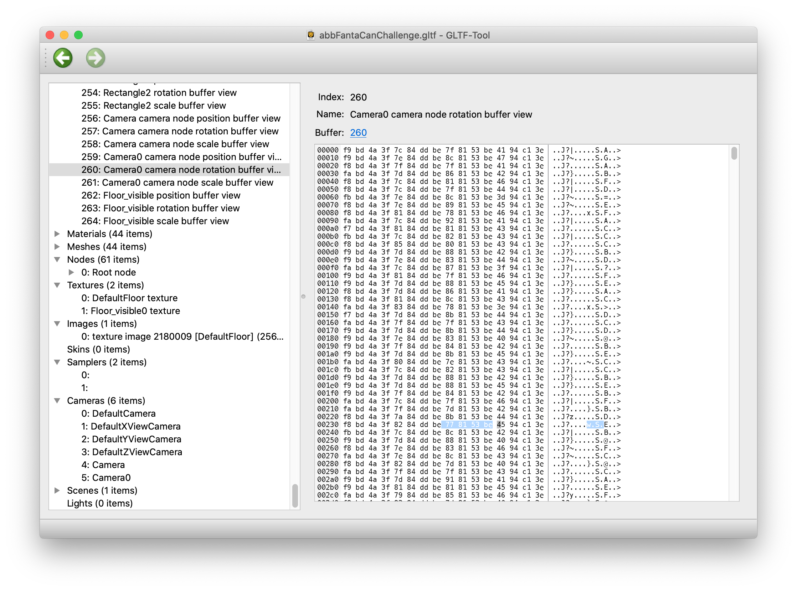

# GLTF-Tool

A tool to inspect GLTF files, using the [TinyGLTF](https://github.com/syoyo/tinygltf) library.



## Building

Requirements:

- CMake 3.16 or newer
- Qt 5 or Qt 6 (Qt 5 is the default)
- Git (the dependencies are fetched during the build)

```sh
cmake -S . -B build
cmake --build build
```

On macOS this produces `build/GLTF-Tool.app`; on other platforms run
`build/GLTF-Tool`.

To build against Qt 6 instead:

```sh
cmake -S . -B build -DQt=Qt6
cmake --build build
```

If CMake cannot find the desired Qt installation, point it at the Qt prefix, for
example with Homebrew:

```sh
cmake -S . -B build -DQt=Qt5 -DCMAKE_PREFIX_PATH=/opt/homebrew/opt/qt@5
cmake -S . -B build -DQt=Qt6 -DCMAKE_PREFIX_PATH=/opt/homebrew/opt/qtbase
```

Use a separate build directory when switching between Qt 5 and Qt 6.

On macOS with Homebrew Qt 6, running the app directly from the build tree may
require setting `QT_PLUGIN_PATH` to the Qt plugin directory (for example
`$(brew --prefix qtbase)/share/qt/plugins`), or deploying the bundle with
`macdeployqt`.

The [TinyGLTF](https://github.com/syoyo/tinygltf) and
[qhexedit2](https://github.com/fferri/qhexedit2) sources are fetched at pinned
commits by CMake's `ExternalProject` during the first build (network access is
required).
